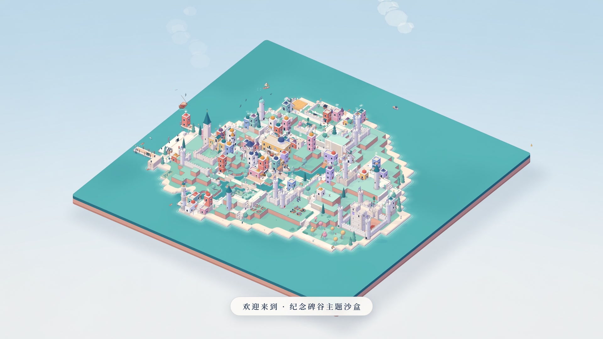
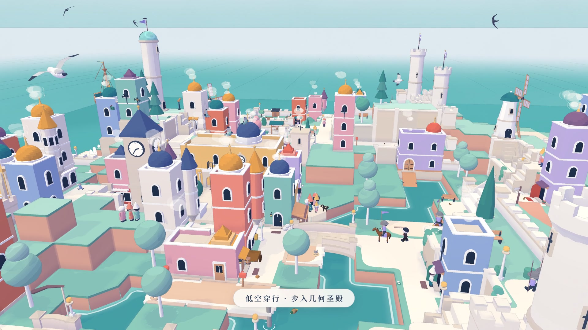
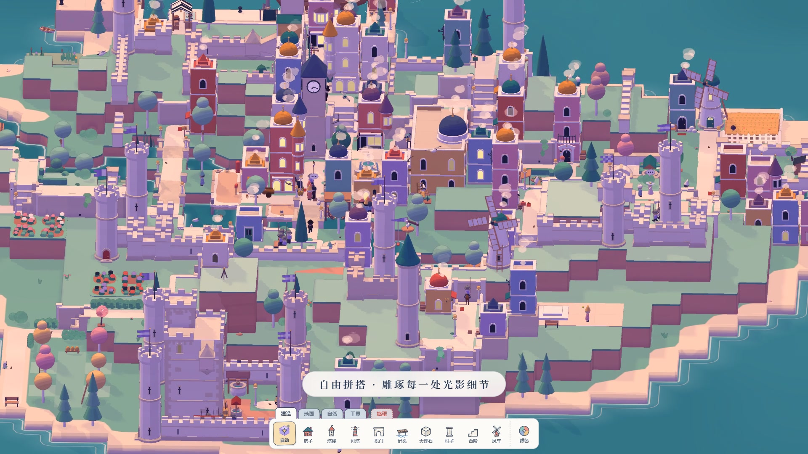
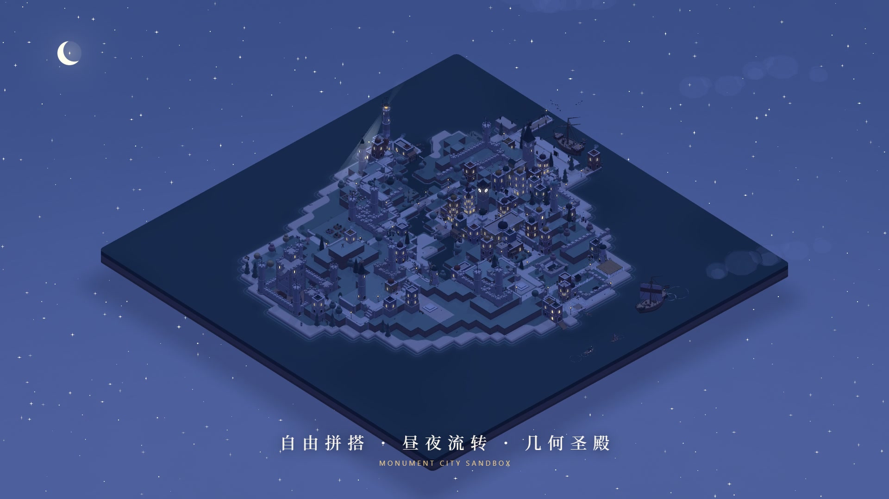

# 纪念碑谷主题沙盒 · Monument Valley Sandbox

一个受《纪念碑谷》启发的 **极简粉彩几何 3D 城建沙盒**（TypeScript + Three.js + 自定义 WebGL2 / GLSL3 渲染管线）。所有几何建筑、圆顶穹窿、高塔城墙、悬浮水域与光影线条均由纯代码程序化生成，点击几下即可生长出一座静谧梦幻的粉彩几何圣殿。



## 视觉亮点

| 3D 低空穿行 · 步入几何圣殿 | 暮色光影 · 自由拼搭细节 | 静谧星夜 · 弯月与灯塔光束 |
| :---: | :---: | :---: |
|  |  |  |

- **纪念碑谷极简粉彩美学**：重构全局调色盘与光照分级，融合象牙白、珊瑚粉、薄荷青、淡薰衣草紫与暖金圆顶，搭配柔和低饱和青碧水面。
- **几何建筑与圣殿廓形**：定制穹顶屋顶、拱形窗洞、极简几何树林与圣殿高塔，告别写实杂乱纹理，保持干净舒展的平面插画质感。
- **自由建造 + 一键生长 + 3D 飞行**：支持从零慢速萌芽生长完整浮空岛，自由切换等轴上帝视角与 3D 低空穿行视角，体验白昼、黄昏、星夜与破晓的柔和流转。
- **定制静谧氛围配乐**：内嵌与粉彩几何画风契合的定制氛围 BGM。

## 本地运行

需要 Node.js `>= 22.12`：

```bash
git clone https://github.com/N0tANTi/monument-valley-sandbox.git
cd monument-valley-sandbox
npm install
npm run dev
```

打开浏览器访问 `http://localhost:5173/?lang=zh` 即可开始拼搭或飞行游览。

```bash
npm run typecheck   # TypeScript 类型检查
npm run build       # 构建生产包
```

## 致谢与许可

- 本项目基于开源浏览器城建引擎 [yaoderek/littlecity](https://github.com/yaoderek/littlecity)（MIT License）进行纪念碑谷主题美学、建筑原型、着色器与配乐重构。
- 许可协议：[MIT](LICENSE)
